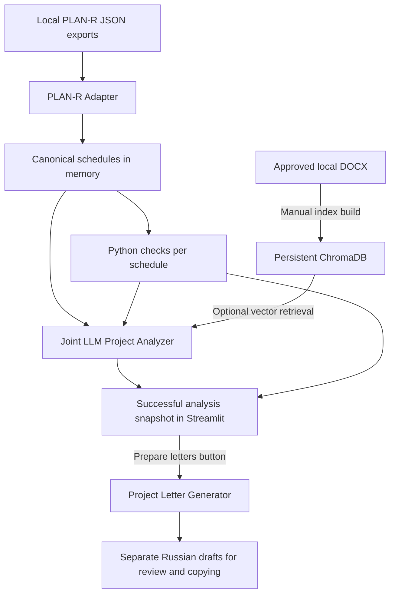

# Architecture

## Scope

AI Project Control Agent is a local, manually operated Streamlit application. PLAN-R exports are read from disk, normalized in memory, checked in Python and submitted for one joint AI analysis. Optional corporate retrieval supplies regulatory evidence. A separate user action prepares a set of email drafts from the completed analysis.

## Components

| Component | Responsibility | Boundary |
| --- | --- | --- |
| PLAN-R Adapter | Resolve attribute keys, UTC dates, WBS, typed relations and EPS names | Reads existing JSON fixtures |
| Canonical Project Model | Represent version ID, display name, items and internal dependencies | In memory |
| Deterministic Python Validation | Detect overdue incomplete items and status/progress mismatches | Runs separately for each schedule |
| Multi-Schedule Analysis | Preserve each schedule's hierarchy, dependencies and findings | Shared analysis date and one request |
| LLM Project Analyzer | Build a management report using schedule data and deterministic findings | Existing OpenAI Responses API |
| Optional Corporate RAG | Extract DOCX, persist embeddings and retrieve excerpts | Independent of project-domain models |
| Project Letter Generator | Draft separate letters from saved findings and project-specific report entries | Additional user-triggered Responses API request |
| Streamlit User Interface | Collect inputs, display results and manage the temporary analysis snapshot | Russian interface, manual actions |

## Data flow

## Schedule identity and validation

`ProjectSchedule` contains `version_id`, `name`, `items` and `dependencies`. Each version comes from the dataset's relations. Empty relations or multiple distinct versions are rejected. EPS resolves the display name through the version's parent schedule node.

An item reference is scoped by `(version_id, item_id)`. Codes are human-readable labels and may coincide across schedules. Python checks receive a single schedule at a time; findings remain indexed by version. Parent and dependency lookup stays local to its containing schedule.

The existing checks use the UTC calendar finish date and progress. They do not calculate a critical path or infer dependency-driven schedule impact.

## Joint analysis contract

`build_context()` creates a shared date and an array of schedules. Each schedule retains its full canonical WBS, internal typed dependencies and findings.

`analyze_project()` makes one model request for all selected schedules. Its strict report schema contains four shared sections. Each entry contains references scoped by version and item ID; a null item ID denotes a whole-schedule observation. Returned references and codes are checked against the input.

The analyzer can examine items without deterministic findings. Rules for current and target dates, summary items, dependency uncertainty and unsupported conclusions remain in its prompt.

## Independent corporate retrieval

The `src/rag/` package depends on DOCX, ChromaDB and embedding services. It imports no PLAN-R adapter, canonical schedule model, workflow or project analyzer.

- `loader.py` extracts paragraphs and table-cell contents and splits text at 1000/200.
- `index.py` builds and loads local persistent collections and exposes statistics.
- `search.py` retrieves three vector-nearest excerpts with filenames.

The UI prepares the retrieval query and passes formatted source/excerpt text to the analyzer's optional `normative_context` argument. Without that argument, the original prompt and context are retained. In RAG mode, unavailable retrieval blocks the AI analysis. Indexing is an explicit knowledge-base action.

## Letter generation boundary

`src/agent/letters.py` accepts canonical schedules, saved deterministic findings, the structured analysis and its date. It reuses the existing model setting and OpenAI client pattern.

For each version it supplies only that project's findings, exclusively project-specific analysis entries and details of referenced items. A shared report entry referencing several versions is omitted from letter inputs to avoid transmitting another project's facts inside free text. The original joint report is preserved.

One additional model request returns `letters`, each with `version_id`, `subject` and `body`. The generator verifies nonempty subjects, the neutral Russian greeting, and an exact one-to-one correspondence with selected versions. The UI maps IDs back to names and provides copyable text. No contacts, delivery integration or transport layer exist.

## Session lifecycle

Streamlit stores one successful snapshot and its letter drafts in `st.session_state`. The snapshot is bound to the selected set of fixture directories, analysis date and RAG mode.

- A new analysis discards earlier snapshots and drafts before execution.
- A changed input selection invalidates the previous result.
- Letter preparation reads the saved snapshot without rerunning the adapter, checks, analyzer or retrieval.
- A letter-generation error preserves the analysis for retry.
- Local labels are cached for the browser session. Restart the session after changing local EPS names.

Only the corporate vector index persists on disk. Analysis and letters are session-local.

## Human review and confidentiality

A strict schema and validated identifiers constrain structure, but free-text claims still require review. Retrieval is incomplete and does not prove compliance.

Private fixtures, corporate documents, secrets and vector storage are excluded from Git. Published documentation describes contracts and synthetic examples. Outbound API calls can contain approved project data and regulatory excerpts; deployment requires the owner's authorization for that use.
